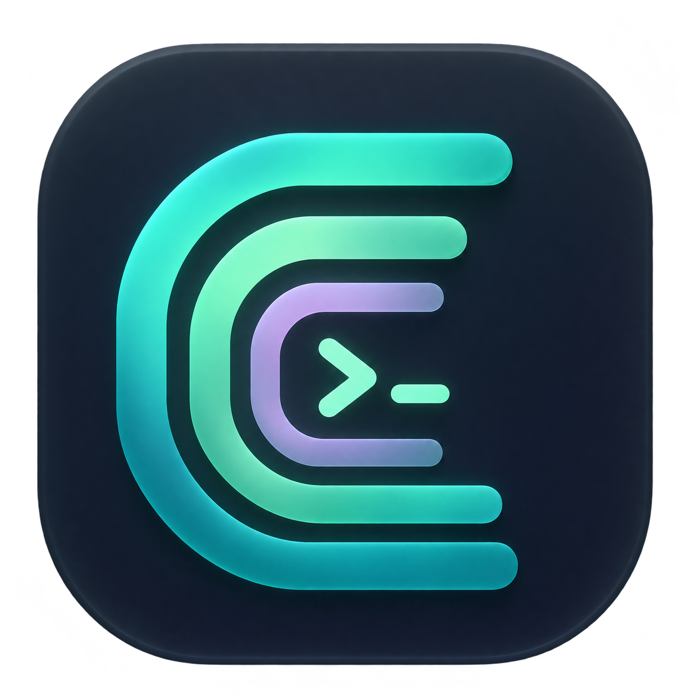
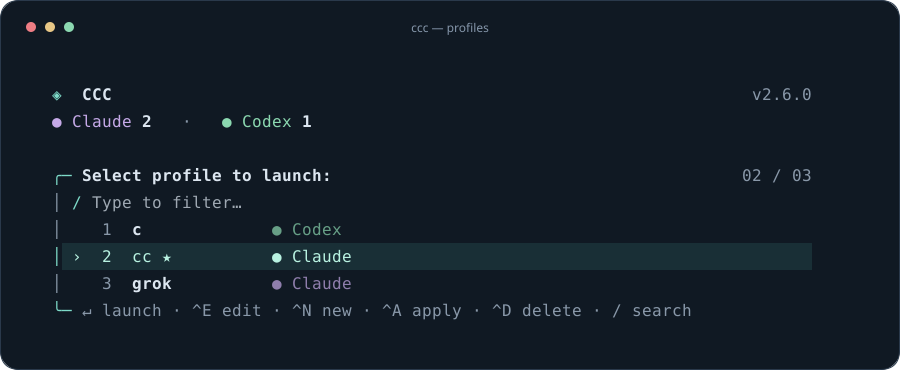

<p align="center">
  
</p>
<h1 align="center">ccc</h1>
<p align="center">Your Claude Code and Codex profiles. One quiet, fast launcher.</p>
<p align="center"><a href="https://www.npmjs.com/package/@tkpdx01/ccc">npm</a> · Node.js 18+ · macOS / Linux / Windows · Zero runtime dependencies</p>



## Start

```bash
npm install -g @tkpdx01/ccc
ccc new                   # add a Claude, Codex, or DeepSeek profile
ccc                       # choose a profile and press Enter
ccc default cc            # preselect cc next time
ccc c                     # launch by name
```

The picker opens directly on your profiles. A soft highlight, provider colors,
instant search, and a ★ default marker keep the screen easy to scan. English and
Chinese are built in. Small terminals, Unicode names, `NO_COLOR`, and redirected
output are supported.

| In the picker | Action |
| --- | --- |
| Enter | Launch selected profile |
| ↑ / ↓ or j / k | Move |
| Type or / | Search; / also searches names starting with j, k, or q |
| Esc / Ctrl+U | Clear search / clear query |
| Ctrl+E / Ctrl+N | Edit / create |
| Ctrl+A / Ctrl+D | Apply globally / archive |
| Ctrl+S / Ctrl+F | Details / set default |
| Ctrl+L / Ctrl+R | Switch language / restore |
| q or Esc outside search | Exit |

Home, End, Page Up, and Page Down work in longer lists. Management actions return
to the picker. In scripts, give an explicit profile; bare `ccc` prints the list
when input or output is redirected.

## Commands

| Command | Purpose |
| --- | --- |
| `ccc list` | List profiles (`ls` also works) |
| `ccc new [name]` | Create a profile |
| `ccc edit [profile]` | Edit credentials, model, or name |
| `ccc show [profile]` | Inspect with secrets masked |
| `ccc default [profile]` | Read or set the default; `--clear` resets it |
| `ccc apply [profile]` | Update global credentials with a recovery snapshot |
| `ccc delete [profile]` | Archive a profile, including its sessions |
| `ccc cleanup --keep c cc grok` | Preview a batch cleanup |
| `ccc restore [id]` | List recovery records or restore one |

```bash
ccc cc -p "Explain this project" --output-format json
ccc c -- exec "Explain this project"
ccc cc -- --help           # forward flags that ccc also understands
ccc 2                     # launch by list position; exact names take priority
ccc c -d                  # bypass Codex approvals and sandbox
```

For Claude, `-d` passes `--dangerously-skip-permissions`. Launcher notices go to
stderr, leaving stdout available for the child CLI's JSON or streamed output.

## Clean up, then restore

```bash
ccc cleanup --keep c cc grok              # preview only
ccc cleanup --keep c cc grok --apply      # review and confirm
ccc restore                              # browse recovery records
ccc restore <id> --dry-run                # preview the affected paths
ccc restore <id>                          # restore
```

Automation can add `--yes` to cleanup with `--apply`, or to restore. Unknown
names in `--keep` stop cleanup. Restore refuses to overwrite an existing
profile or global settings edited since the snapshot.

Codex renaming preserves the complete directory, including sessions, databases,
skills, and instructions. Old names remain as compatibility links for absolute
session paths; only the current name appears in the picker. Cleanup archives
those links together with the profile. Recovery records stay in
`~/.ccc/recovery/` until you remove them.

## How profiles work

```text
Claude profile + global settings → private temporary settings → claude
Codex profile directory         → dedicated CODEX_HOME        → codex
```

Normal launches leave global settings unchanged. Claude temporary files are
private and cleaned up on exit. Profile credentials are saved atomically with
owner-only permissions on POSIX systems; key input is hidden.

`apply` merges Claude settings. For Codex it updates the selected model/provider
and credentials while preserving MCP servers, project trust, and other global
preferences. Both create recovery snapshots. Codex credentials follow the active
provider, and editing preserves models missing from `/models`.

Legacy full Claude settings and slim Codex JSON profiles remain supported.
AnyRouter's 1M context overlay is applied automatically. Claude defaults
`skipWebFetchPreflight` to `true`; an explicit `false` is respected.

## Small by design

The npm package ships one minified JavaScript entry plus this README and package
metadata. It has **no runtime dependencies**. Screenshots, icons, tests, source
modules, and build tools stay in the repository.

```bash
npm ci
npm test                  # behavior and regression tests
npm run test:package      # build, pack, install, and verify the actual tarball
node scripts/preview.mjs  # refresh the demo from the real picker
```

The only development dependency is a pinned esbuild, used for release bundling.
CI checks Node.js 18, 20, 22, and 24 on Linux, macOS, and Windows. Commit
`package-lock.json` alongside dependency changes.

## 中文速用

运行 `ccc` 直接选择配置，回车启动；`ccc default cc` 设置默认选中项。
`Ctrl+L` 切换中英文。清理先预览，删除可恢复，改名保留完整会话。

## License

MIT
